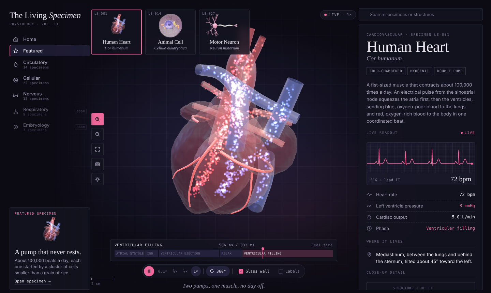
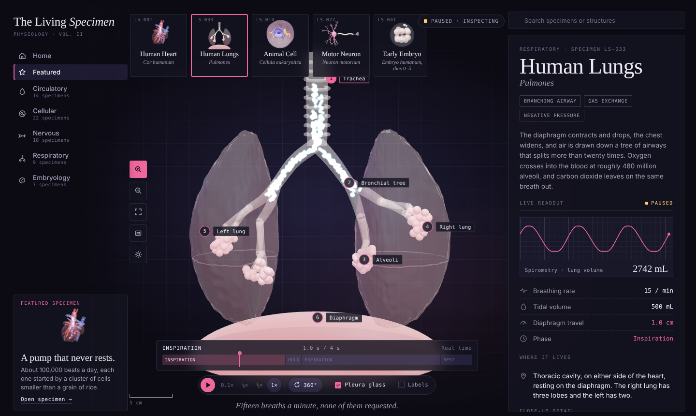
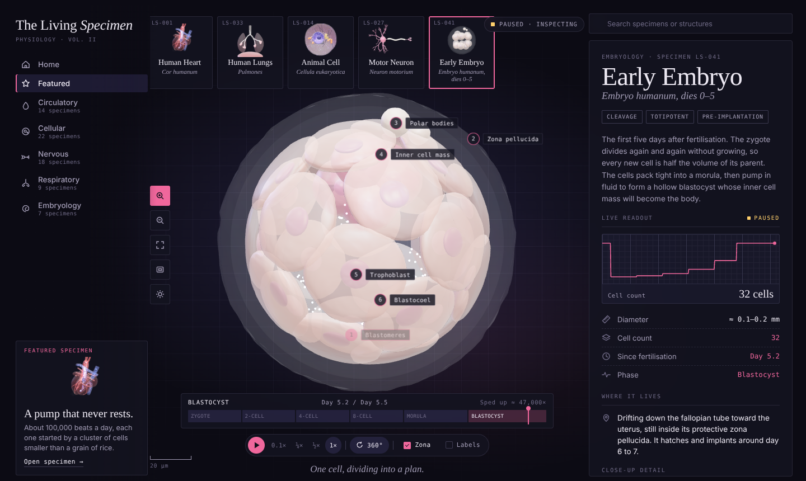
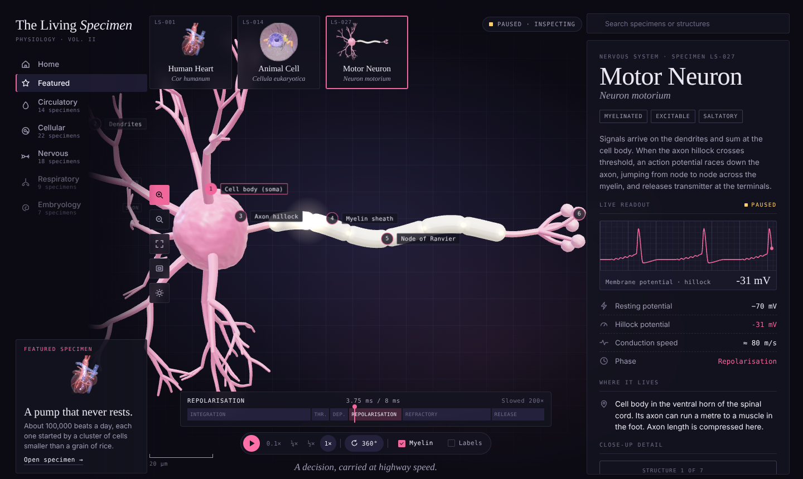
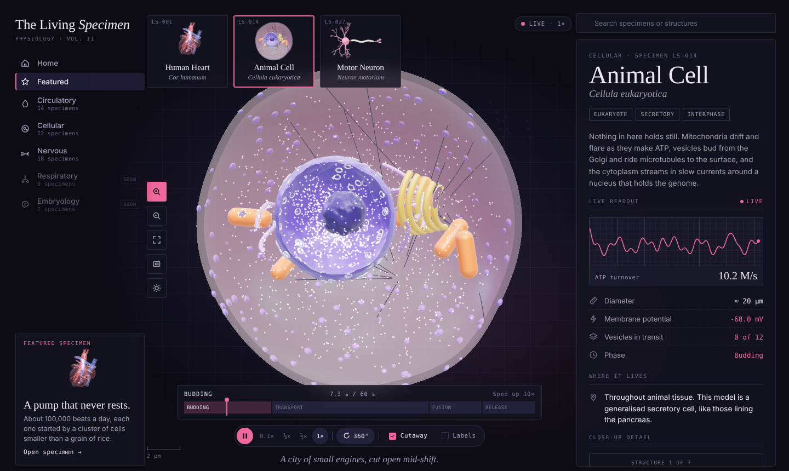
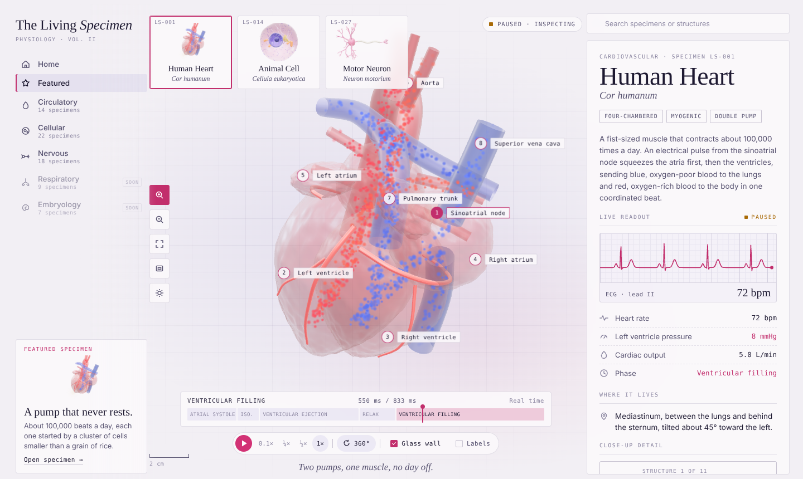
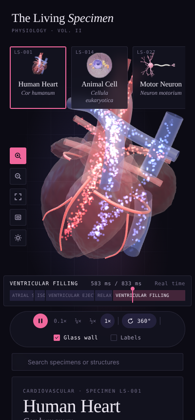

<div align="center">

# The Living Specimen

**An interactive anatomy atlas where nothing holds still.**

Internal parts rotate, fluids flow, particles react and layers pulse. Pause at any moment to inspect the details.

[Live demo](https://ramakm.github.io/TheLivingSpecimen/) · [Features](#features) · [Run locally](#run-locally) · [How it works](#how-it-works)




</div>

## Concept

Most 3D anatomy viewers show a frozen model. The Living Specimen treats each specimen as a working system. The heart beats, the lungs breathe, the cell keeps working, the neuron fires and the embryo divides, and every readout on the page stays in sync with that motion.

When you want to study something, stop time. Labels appear, and you can scrub through a single cycle frame by frame.

It works best for anatomy, biological systems and dynamic simulations.

## Specimens

| ID | Specimen | Cycle | What moves |
|---|---|---|---|
| LS-001 | **Human Heart** · *Cor humanum* | 833 ms, real time | Atria, then ventricles, contract at 72 bpm. Blue (oxygen-poor) and red (oxygen-rich) blood flows through the chambers and great vessels. An electrical impulse fires at the SA node, pauses at the AV node and runs down the septum to the apex. |
| LS-033 | **Human Lungs** · *Pulmones* | 4 s, real time | The diaphragm contracts and drops while the chest widens. Air flows down the trachea and a branching bronchial tree to clusters of alveoli. Particles turn from cool blue (oxygen-rich, in) to amber (carbon-dioxide-rich, out) at the moment of gas exchange, and the alveoli glow. |
| LS-014 | **Animal Cell** · *Cellula eukaryotica* | 60 s, sped up 10× | A live cutaway that always faces the camera. The membrane ripples, mitochondria drift and flare, the cytoplasm streams, and vesicles bud from the Golgi, ride microtubules and fuse with the membrane to release cargo. |
| LS-027 | **Motor Neuron** · *Neuron motorium* | 8 ms, slowed 200× | Signals travel down the dendrites and sum at the soma. An action potential jumps node to node along the myelin (saltatory conduction) and releases neurotransmitter at the terminals. |
| LS-041 | **Early Embryo** · *Embryo humanum, dies 0–5* | Day 0–5.5, sped up ≈ 47,000× | Cleavage from zygote → 2 → 4 → 8 cells, compaction into a 16-cell morula, then a 32-cell blastocyst with a fluid-filled blastocoel, flattened trophoblast and an inner cell mass. Cells halve in volume at each division without growing, and a glow marks each mitosis. |

## Features

### Inspect a living system
- **Pause and play.** Pausing reveals numbered labels on the model and switches the status to *Paused · inspecting*.
- **Phase timeline.** Drag through one cycle, for example atrial systole → ejection → filling. The active phase is highlighted.
- **Speed control:** 0.1×, ¼×, ½× or 1×.
- **Layer toggle** per specimen: glass heart wall, glass pleura, cell cutaway, myelin sheath or zona pellucida.
- **Click any structure** to open it in the close-up card. Hover shows its name. Search finds both specimens and structures.

### A live dossier
- **Signal trace** in the side panel: an ECG (lead II), a spirometry lung-volume curve, ATP turnover, membrane potential at the axon hillock, or the embryo's cell count stepping up at each division.
- **Live values** such as left ventricle pressure (mmHg), diaphragm travel (cm), hillock potential (mV), vesicles in transit, embryo cell count and day since fertilisation, plus the current phase.
- Readouts are computed from simulation time, so they **freeze on pause and follow the scrubber**.

### View
- Drag to orbit, scroll or use the toolbar to zoom, toggle 360° auto-rotate, reset the view and go full screen.
- **A true scale bar** recalculates as you zoom (cm for the heart and lungs, µm for the cell, neuron and embryo).
- **Light and dark themes.** The theme follows your system by default, and the sun button switches it.
- **Responsive.** On phones the stage stacks above the dossier.
- Respects `prefers-reduced-motion` by starting paused.

## Keyboard shortcuts

| Key | Action |
|---|---|
| <kbd>Space</kbd> | Pause or play |
| <kbd>←</kbd> / <kbd>→</kbd> | Step 1% through the cycle (when paused, or with the timeline focused) |
| <kbd>Enter</kbd> in search | Jump to the first match |
| <kbd>Esc</kbd> in search | Close results |

## Run locally

The project is a single static file with no dependencies to install.

```bash
git clone https://github.com/Ramakm/TheLivingSpecimen.git
cd TheLivingSpecimen
python3 -m http.server 8000     # or: npx serve .
```

Then open <http://localhost:8000>.

Opening `index.html` directly also works in most browsers. The page loads Three.js from jsDelivr through an import map and fonts from Google Fonts, so it needs an internet connection.

### Deploy on GitHub Pages

1. Go to **Settings → Pages**.
2. Under *Build and deployment*, choose **Deploy from a branch**.
3. Select `main` and `/ (root)`, then save.

The site goes live at `https://ramakm.github.io/TheLivingSpecimen/`.

## How it works

```
index.html
├── <style>     design tokens (light + dark), layout, HUD, dossier
├── <script type="importmap">   three@0.160.0 from jsDelivr
└── <script type="module">
    ├── utilities        noise (fbm), organicSphere, taperTube, curve LUTs
    ├── buildHeart()     chambers, vessels, coronaries, blood flow, conduction
    ├── buildCell()      membrane, nucleus, ER, Golgi, mitochondria, vesicles
    ├── buildLungs()     trachea, bronchial tree, alveoli, diaphragm, airflow
    ├── buildNeuron()    soma, dendrite tree, axon, myelin, nodes, terminals
    ├── buildEmbryo()    zona, cleavage lineage, morula, blastocyst, blastocoel
    ├── scene + UI       camera, controls, pins, timeline, trace, search
    └── frame loop       advance time → update specimen → render → readouts
```

**Procedural geometry, no model files.** Organs are noise-displaced spheres. Vessels, airways, dendrites and the ER are tapered tubes along Catmull-Rom curves, and the bronchial and dendritic trees are grown recursively from a seeded random generator. Coronary arteries are placed by raycasting onto the ventricle surface. The embryo is a precomputed division lineage: each cell knows its parent, so a division is just an interpolation from parent to child.

**Deterministic animation.** Each specimen exposes `update(t, f)`, where `t` is simulation time and `f` is the cycle phase (0–1). Every motion is a pure function of those two values, which is why pause and scrub are exact. Blood flow uses a precomputed integral of the cardiac envelope, so particles surge during ejection yet land in the same place whichever way you scrub.

**Particles.** A custom point shader draws blood cells, cytoplasm, ribosomes and neurotransmitter. It does world-space clipping for the cell cutaway and switches between additive (dark) and normal (light) blending.

**Materials.** `MeshPhysicalMaterial` with clearcoat and sheen gives the wet-tissue look, lit by a `RoomEnvironment` and coloured rim lights.

**Palette.** The colours come from H&E histology stain: hematoxylin violet, eosin pink and an amber "voltage" accent for electrical activity.

### Add a specimen

Write a `buildX()` function that returns an object with:

```js
{
  id, period, root,                 // seconds per cycle, THREE.Group
  update(t, f, ctx) {},             // animate from time + phase
  phases: [{ name, a, b }],         // timeline segments (0–1)
  signal(f, t), sigRange, traceWin, // live trace
  traits: [{ icon, k, v(f, t), live }],
  parts: [{ key, name, color, desc, anchor: [object3D, localVec3] | null }],
  layer: { label, on, set(on) },
  pick: [meshes], cam: { pos, target }, scale: { per, unit, cands },
  cycle: { len, unit, dp }, timeScale, timeLabel?(f), meta: { id, eyebrow, name, latin, tags, desc, where, trace, caption },
}
```

Then add it to the `specimens` array. The cards, thumbnails, dossier, pins and timeline are generated from this object.

## Roadmap

- [x] Respiratory: lungs with airflow and alveolar gas exchange
- [x] Embryology: cleavage from zygote to blastocyst
- [ ] Embryology, part two: hatching, implantation and gastrulation
- [ ] Valve close-ups and a pressure–volume loop for the heart
- [ ] Shareable links to a specimen and phase

## Screenshots

| Human lungs | Early embryo (blastocyst) | Motor neuron |
|---|---|---|
|  |  |  |

| Animal cell | Light theme | Mobile |
|---|---|---|
|  |  |  |

## Accuracy note

This project is an educational visualisation, not a medical reference. Shapes are stylised, the neuron's axon is compressed, the lung airway tree shows only a handful of its ~23 generations, and timings are scaled where marked (cell 10× faster, neuron 200× slower, embryo ≈ 47,000× faster). Physiological values are typical textbook figures for a healthy adult at rest.

## License

[MIT](LICENSE) © 2026 Ramakrushna Mohapatra

---

<div align="center">

Built by **Ramakrushna Mohapatra** · [techwithram.com](https://techwithram.com) · [@techwith.ram](https://instagram.com/techwith.ram) · [X @techwith_ram](https://x.com/techwith_ram) · [LinkedIn](https://www.linkedin.com/in/ramakrushnamohapatra)

</div>
